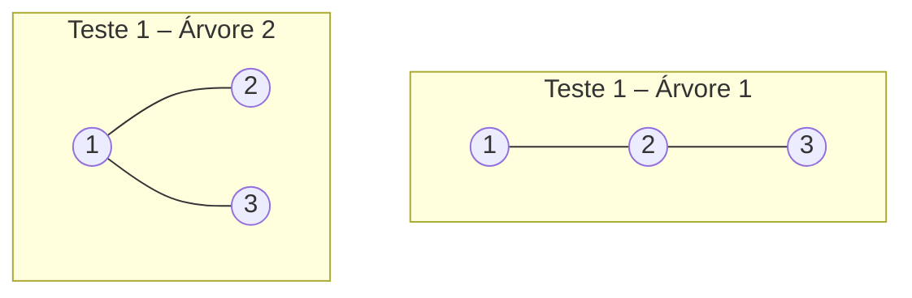
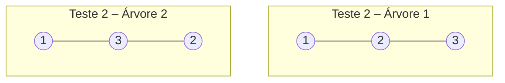

# Marco 1 — Problema e conhecimento prévio

**Problema:** Tree Isomorphism (CSES), isomorfismo de árvores enraizadas no vértice 1.

---

## 1. Resumo do problema

Dadas duas árvores enraizadas, decidir se são **isomorfas**, isto é, se é possível desenhá-las de modo que fiquem iguais.

### Entrada
- Um inteiro `t`, o número de testes.
- Para cada teste:
  - um inteiro `n`, o número de nós **em ambas** as árvores, numerados de `1` a `n`, com o **nó 1 sendo a raiz**;
  - `n − 1` linhas `a b` com as arestas da **primeira** árvore;
  - `n − 1` linhas `a b` com as arestas da **segunda** árvore.

As arestas são pares não ordenados. O par `a b` **não indica** quem é o pai. No exemplo, a linha `3 2` liga o nó 3 ao nó 2, e é a raiz 1 que define o sentido pai → filho.

### Saída
Para cada teste, `YES` se as árvores são isomorfas e `NO` caso contrário.

### Restrições
| Item | Valor |
|---|---|
| Tempo | 1,00 s |
| Memória | 512 MB |
| `1 ≤ t ≤ 1000` | número de testes |
| `2 ≤ n ≤ 10⁵` | nós por árvore |
| `Σ n ≤ 10⁵` | soma de `n` em todos os testes |

### Exemplo do enunciado

```
Entrada          Saída
2                NO
3                YES
1 2
2 3
1 2
1 3
3
1 2
2 3
1 3
3 2
```

---

## 2. Modelagem

| Elemento | Modelagem |
|---|---|
| **Vértice** | cada nó `v ∈ {1, …, n}` |
| **Aresta** | cada par `{a, b}` de uma árvore, lido como não dirigido |
| **Raiz** | vértice 1. Ela induz a orientação pai → filho |
| **Representação** | lista de adjacência `adj[v]`, uma por árvore |
| **Auxiliares** | `pai[v]`, `filhos[v]` e `id[v]` (identificador canônico da subárvore de `v`) |

Para cada `v`, a subárvore `T(v)` é formada por `v` e seus descendentes. A árvore inteira é `T(1)`. Os filhos **não têm ordem**, então `1→{2,3}` e `1→{3,2}` são a mesma árvore.

---

## 3. Classificação do grafo

| Propriedade | Classificação |
|---|---|
| Direção | **não dirigido** (a orientação pai → filho é derivada da raiz) |
| Pesos | **não ponderado** |
| Multiplicidade | **simples** |
| Conectividade | **conexo** |
| Ciclos | **acíclico**, portanto uma **árvore** (`|E| = n − 1`) |
| Densidade | **esparso** (`|E| = Θ(|V|)`) |
| Estrutura | **enraizado em 1**. Existe caminho único entre dois vértices e o grafo é bipartido |

---

## 4. Resultado de aprendizagem aferido

> Ajuste este texto à ementa da disciplina.

- **Modelar** um problema computacional como um problema em grafos, escolhendo representação e classificação adequadas.
- **Aplicar** DFS/BFS para extrair estrutura (pais, filhos, níveis, pós-ordem) de um grafo.
- **Projetar e analisar** um algoritmo (forma canônica de árvores enraizadas), justificando correção e complexidade frente aos limites do problema.

---

## 5. Como DFS/BFS participa da solução

O algoritmo calcula, para cada vértice, um **identificador canônico** da sua subárvore (ideia de Aho–Hopcroft–Ullman):

1. **Orientar a árvore.** Uma DFS (ou BFS) a partir do vértice 1 define `pai[v]` e `filhos[v]`. É indispensável, pois a entrada traz arestas não dirigidas, como a linha `3 2` do exemplo.
2. **Processar de baixo para cima.**
   - Pela DFS, usa-se a **pós-ordem**, em que cada vértice é processado depois dos filhos.
   - Pela BFS, os níveis são processados do mais profundo até a raiz.
3. **Atribuir `id[v]`.** Para cada `v`, monta-se a lista `[id[f] para cada filho f]`, ordena-se e consulta-se um dicionário. Lista nova recebe um novo id e lista já vista reaproveita o id. Folha corresponde à lista vazia.
4. **Comparar.** As árvores são isomorfas se, e somente se, `id₁[1] = id₂[1]`.

O dicionário é **compartilhado pelas duas árvores do mesmo teste**, para que os ids sejam comparáveis. Ele é reiniciado a cada teste.

**Por que funciona:** duas subárvores enraizadas são isomorfas exatamente quando os multiconjuntos de filhos têm subárvores duas a duas isomorfas. A ordenação remove a dependência da ordem da entrada.

---

## 6. Instância pequena (exemplo do enunciado, n = 3)

### Teste 1

- **Árvore 1:** arestas `1 2` e `2 3`. É um caminho `1 → 2 → 3`.
- **Árvore 2:** arestas `1 2` e `1 3`. A raiz tem dois filhos.



### Teste 2

- **Árvore 1:** arestas `1 2` e `2 3`, o caminho `1 → 2 → 3`.
- **Árvore 2:** arestas `1 3` e `3 2`, o caminho `1 → 3 → 2`.



### Listas de adjacência

| v | T1 (teste 1) | T2 (teste 1) | T1 (teste 2) | T2 (teste 2) |
|---|---|---|---|---|
| 1 | 2 | 2, 3 | 2 | 3 |
| 2 | 1, 3 | 1 | 1, 3 | 3 |
| 3 | 2 | 1 | 2 | 1, 2 |

---

## 7. Rastreamento

O dicionário `D` (lista ordenada de ids dos filhos → id) começa vazio em cada teste.

### Teste 1

**Árvore 1:** DFS a partir de 1, com pós-ordem 3, 2, 1.

| Passo | Vértice | Filhos | Lista de ids | Ação em `D` | `id` |
|---|---|---|---|---|---|
| 1 | 3 | — | `()` | novo | **0** |
| 2 | 2 | 3 | `(0)` | novo | **1** |
| 3 | 1 | 2 | `(1)` | novo | **2** |

`id₁[1] = 2`.

**Árvore 2:** DFS a partir de 1, com pós-ordem 2, 3, 1.

| Passo | Vértice | Filhos | Lista de ids | Ação em `D` | `id` |
|---|---|---|---|---|---|
| 1 | 2 | — | `()` | já existe | 0 |
| 2 | 3 | — | `()` | já existe | 0 |
| 3 | 1 | 2, 3 | `(0, 0)` | novo | **3** |

`id₂[1] = 3 ≠ 2` → **NO**. A árvore 1 tem altura 2 e a árvore 2 tem altura 1.

### Teste 2

**Árvore 1:** igual à do teste 1, `D = { () → 0, (0) → 1, (1) → 2 }` e `id₁[1] = 2`.

**Árvore 2:** a aresta `3 2` é orientada pela busca como `3 → 2`. Pós-ordem 2, 3, 1.

| Passo | Vértice | Filhos | Lista de ids | Ação em `D` | `id` |
|---|---|---|---|---|---|
| 1 | 2 | — | `()` | já existe | 0 |
| 2 | 3 | 2 | `(0)` | já existe | 1 |
| 3 | 1 | 3 | `(1)` | já existe | **2** |

`id₂[1] = 2 = id₁[1]` → **YES**, com a bijeção `1→1, 2→3, 3→2`.

Saída obtida: `NO` e `YES`, igual à do enunciado ✓.

---

## 8. Justificativas e complexidade

- **Correção:** por indução na altura, `id[u] = id[v]` se e somente se `T(u) ≅ T(v)`. Folhas têm lista vazia. Em um nó interno, listas iguais após a ordenação significam um emparelhamento de filhos com subárvores isomorfas.
- **Tempo:** a busca custa `Θ(n)`. A soma dos tamanhos de todas as listas de filhos é `n − 1`, então ordenar e consultar o dicionário custa `O(n log n)` no total. Com `Σ n ≤ 10⁵`, isso fica bem dentro de 1 s.
- **Espaço:** `Θ(n)` para as listas de adjacência, `pai`, `id` e o dicionário. Os 512 MB são largamente suficientes.
- **Cuidado com recursão:** com `n` até `10⁵`, uma árvore em forma de caminho gera profundidade 10⁵. Use DFS **iterativa** ou BFS por níveis para não estourar a pilha.
- **Cuidado com várias entradas:** reinicie as estruturas a cada teste (`t` até 1000). Use leitura rápida, pois a entrada tem até `2·10⁵` linhas de aresta.