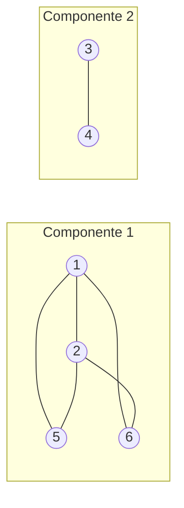

# Marco 2 — Componentes conexas

Caso particular do problema das árvores enraizadas no vértice 1, **adaptado a um grafo simples e não dirigido qualquer**, com `V ≤ 6` e `E ≤ 6`. Aqui o grafo pode ter ciclos e várias componentes.

**Ligação com o problema original:** no problema (CSES, Tree Isomorphism) as entradas são árvores, mas, ao adaptar o grafo para um caso geral, é útil poder **verificar** se a entrada é de fato uma árvore. O grafo precisa ter **uma única componente** e `E = V − 1`. O algoritmo deste marco faz essa checagem.

Para o problema real, com `n` até `10⁵`, a DFS deste marco precisaria ser **iterativa**, pois a recursão estouraria a pilha em uma árvore em forma de caminho. Aqui, com `V ≤ 6`, a versão recursiva é adequada para o rastreamento manual.

---

## 1. Instância (grafo aleatório)

O grafo foi gerado aleatoriamente com semente fixa, para ser reproduzível. A condição era ter mais de uma componente.

```python
import random, itertools
random.seed(40)
pares = list(itertools.combinations(range(6), 2))
arestas = [(u + 1, v + 1) for u, v in sorted(random.sample(pares, 6))]
print(arestas)  # [(1, 2), (1, 5), (1, 6), (2, 5), (2, 6), (3, 4)]
```

- **V = 6**, vértices `{1, 2, 3, 4, 5, 6}`.
- **E = 6**, arestas `{1,2}, {1,5}, {1,6}, {2,5}, {2,6}, {3,4}`.
- Grafo **simples, não dirigido e não ponderado**.

### Desenho



### Listas de adjacência (ordem crescente)

| Vértice | Vizinhos |
|---|---|
| 1 | 2, 5, 6 |
| 2 | 1, 5, 6 |
| 3 | 4 |
| 4 | 3 |
| 5 | 1, 2 |
| 6 | 1, 2 |

Soma dos graus = 3 + 3 + 1 + 1 + 2 + 2 = 12 = 2E ✓.

---

## 2. Excentricidade, raio, diâmetro e centro

Definições, calculadas **dentro de cada componente**, pois em um grafo desconexo a distância entre componentes é infinita:

- `exc(v) = max d(v, u)`, para `u` na mesma componente de `v`.
- `raio = min exc(v)` e `diâmetro = max exc(v)`.
- **Vértices centrais** são os que têm `exc(v) = raio`. O **centro** é o conjunto desses vértices.

### Componente 1 = {1, 2, 5, 6}

Matriz de distâncias (BFS a partir de cada vértice):

| d | 1 | 2 | 5 | 6 | **exc** |
|---|---|---|---|---|---|
| **1** | 0 | 1 | 1 | 1 | **1** |
| **2** | 1 | 0 | 1 | 1 | **1** |
| **5** | 1 | 1 | 0 | 2 | **2** |
| **6** | 1 | 1 | 2 | 0 | **2** |

`d(5,6) = 2`, porque não há aresta 5–6 e o caminho passa por 1 ou por 2.

- **Raio = 1** e **diâmetro = 2**.
- **Vértices centrais = {1, 2}**.
- **Centro da componente = {1, 2}**.

Exemplo de BFS a partir do 5:
- nível 0 = {5};
- nível 1 = {1, 2};
- nível 2 = {6}.

A profundidade máxima é 2, logo `exc(5) = 2`.

### Componente 2 = {3, 4}

| d | 3 | 4 | **exc** |
|---|---|---|---|
| **3** | 0 | 1 | **1** |
| **4** | 1 | 0 | **1** |

- **Raio = 1** e **diâmetro = 1**.
- **Vértices centrais = {3, 4}**.
- **Centro da componente = {3, 4}**.

### Resumo

| Componente | Vértices | exc | Raio | Diâmetro | Centro |
|---|---|---|---|---|---|
| C1 | 1, 2, 5, 6 | 1:1, 2:1, 5:2, 6:2 | 1 | 2 | {1, 2} |
| C2 | 3, 4 | 3:1, 4:1 | 1 | 1 | {3, 4} |

**Validação para o problema original:**
- C1 tem 4 vértices e 5 arestas, logo contém ciclos e **não é árvore**.
- C2 tem 2 vértices e 1 aresta, logo **é árvore**.
- O grafo inteiro tem 2 componentes, então a entrada seria **rejeitada** como árvore.

---

## 3. Algoritmo de componentes conexas (DFS recursiva)

```text
componentes(G):
    comp[1..V] ← 0              # 0 = não visitado
    c ← 0
    para v de 1 até V:
        se comp[v] = 0:
            c ← c + 1
            DFS(v, c)
    retornar c, comp

DFS(u, c):
    comp[u] ← c
    para cada w em adj[u]:
        se comp[w] = 0:
            DFS(w, c)
```

### Estruturas de dados

| Estrutura | Papel |
|---|---|
| `adj[1..V]` | listas de adjacência, com 2E entradas |
| `comp[1..V]` | rótulo da componente. Serve também como vetor de "visitado" |
| `c` | contador de componentes |
| pilha de recursão | implícita, profundidade máxima ≤ V |

### Lógica
O laço externo percorre os vértices em ordem. Um vértice ainda com `comp = 0` não foi alcançado por nenhuma busca anterior, então pertence a uma **nova componente**. A DFS marca todos os vértices alcançáveis a partir dele com o mesmo rótulo.

### Rastreamento

Estado inicial: `comp = [0, 0, 0, 0, 0, 0]` (índices 1..6) e `c = 0`.

| Passo | Ação | Pilha de chamadas | `comp` [1..6] | `c` |
|---|---|---|---|---|
| 1 | laço `v=1`, `comp[1]=0`, nova componente | — | 0 0 0 0 0 0 | 1 |
| 2 | `DFS(1,1)`: marca 1 | 1 | **1** 0 0 0 0 0 | 1 |
| 3 | vizinho 2 não visitado, chama `DFS(2,1)` | 1 → 2 | 1 **1** 0 0 0 0 | 1 |
| 4 | em 2, vizinho 1 já visitado, ignora | 1 → 2 | 1 1 0 0 0 0 | 1 |
| 5 | em 2, vizinho 5 não visitado, chama `DFS(5,1)` | 1 → 2 → 5 | 1 1 0 0 **1** 0 | 1 |
| 6 | em 5, vizinhos 1 e 2 visitados, retorna | 1 → 2 | 1 1 0 0 1 0 | 1 |
| 7 | em 2, vizinho 6 não visitado, chama `DFS(6,1)` | 1 → 2 → 6 | 1 1 0 0 1 **1** | 1 |
| 8 | em 6, vizinhos 1 e 2 visitados, retorna | 1 → 2 | 1 1 0 0 1 1 | 1 |
| 9 | 2 termina e retorna ao 1 | 1 | 1 1 0 0 1 1 | 1 |
| 10 | em 1, vizinhos 5 e 6 já visitados, 1 termina | — | 1 1 0 0 1 1 | 1 |
| 11 | laço `v=2`: `comp[2]=1`, pula | — | 1 1 0 0 1 1 | 1 |
| 12 | laço `v=3`: `comp[3]=0`, nova componente | — | 1 1 0 0 1 1 | 2 |
| 13 | `DFS(3,2)`: marca 3 | 3 | 1 1 **2** 0 1 1 | 2 |
| 14 | vizinho 4 não visitado, chama `DFS(4,2)` | 3 → 4 | 1 1 2 **2** 1 1 | 2 |
| 15 | em 4, vizinho 3 já visitado, retorna. 3 termina | — | 1 1 2 2 1 1 | 2 |
| 16 | laço `v=4,5,6`: todos visitados, pula | — | 1 1 2 2 1 1 | 2 |

**Resultado:** `c = 2` e `comp = [1, 1, 2, 2, 1, 1]`.

- Componente 1 = {1, 2, 5, 6}, ordem de visita 1, 2, 5, 6.
- Componente 2 = {3, 4}, ordem de visita 3, 4.
- A profundidade máxima da recursão foi 3 (1 → 2 → 5), menor que V.

Os resultados coincidem com o desenho e com as componentes usadas na seção 2.

---

## 4. Complexidade

### Tempo
- O laço externo faz `V` iterações, com custo `Θ(V)`.
- `DFS(u)` é chamada **uma única vez por vértice**, porque `comp[u] ≠ 0` impede novas chamadas. Isso dá `V` chamadas.
- Cada lista `adj[u]` é percorrida **uma vez**, no corpo da DFS de `u`. O custo total das varreduras é `Σ grau(u) = 2E`.
- **Tempo total: Θ(V + E)**.
- No caso particular (V = 6, E = 6), são 12 posições de adjacência varridas.

### Espaço
- Listas de adjacência: `Θ(V + E)`.
- Vetor `comp`: `Θ(V)`.
- Pilha de recursão: `O(V)` no pior caso (grafo em forma de caminho).
- **Espaço total: Θ(V + E)**, e o **espaço auxiliar** é `Θ(V)`.
- Uma matriz de adjacência custaria `Θ(V²)` de espaço e `Θ(V²)` de tempo. A lista é melhor para grafos esparsos, como as árvores do problema original.

### Custo das consultas de conectividade
Depois do pré-processamento `Θ(V + E)`, a consulta "u e v estão na mesma componente?" é:

```text
conectados(u, v) = (comp[u] == comp[v])
```

- **Custo por consulta: Θ(1)**.
- Para `q` consultas, o total é `Θ(V + E + q)`.
- Sem pré-processamento, cada consulta exigiria uma busca em `O(V + E)`, ou seja, `O(q·(V + E))` no total.
- Exemplos nesta instância:
  - `conectados(1, 6)`: `comp[1]=1` e `comp[6]=1`, **verdadeiro**.
  - `conectados(2, 3)`: `comp[2]=1` e `comp[3]=2`, **falso**.
- Para grafos que **mudam** (inserção de arestas), a alternativa é Union-Find, com custo amortizado `O(α(V))` por operação.
- O **número de componentes** é o valor `c` retornado, sem custo adicional.
- O custo de calcular as excentricidades por BFS a partir de cada vértice é `Θ(V·(V + E))`.
