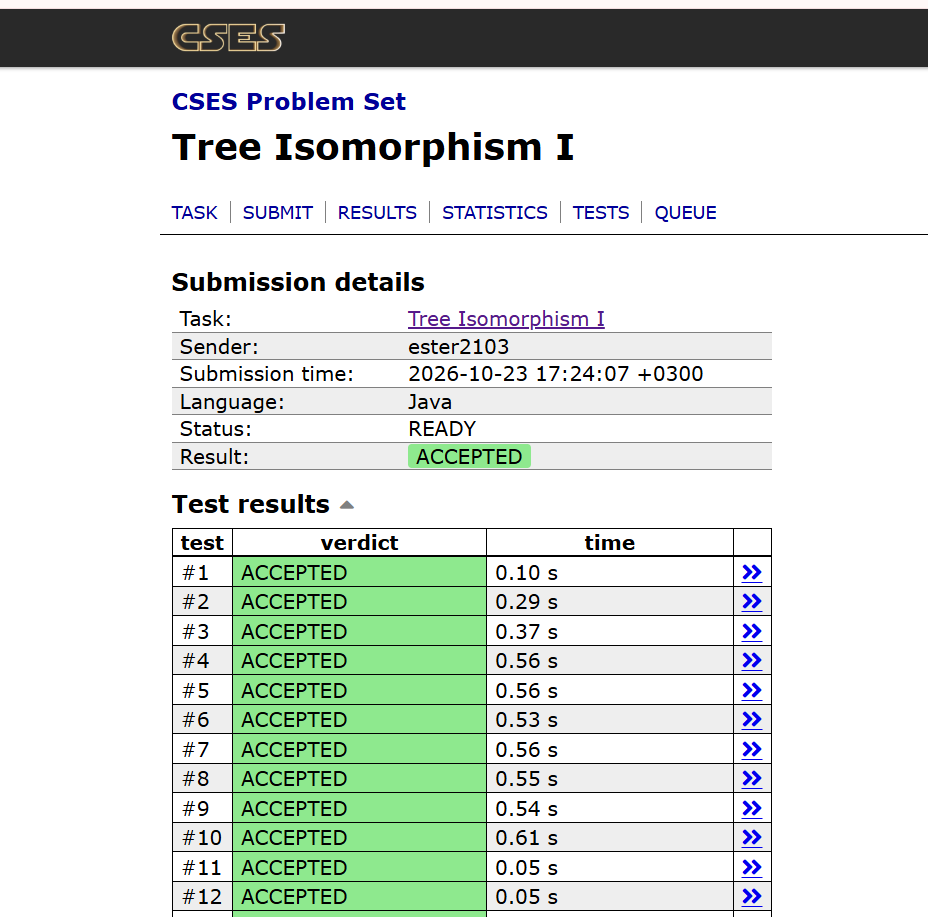

# Isomorfismo de Árvores Enraizadas

Dadas duas árvores enraizadas no vértice 1, decidir se são **isomorfas**, isto é, se é possível desenhá-las de modo que fiquem iguais. Problema *Tree Isomorphism I* do CSES.

## Integrantes

- Ester dos Santos da Silva · 2324328
- Leonardo Enzo Pinheiro Diogenes · 2420372

## Linguagem

Java, com as implementações de referência `Bag`, `Stack` e `Graph` do `algs4` incorporadas ao `src/Main.java`.

## Execução

```bash
# Java 11 ou superior: compila e executa em um passo
java src/Main.java < dados/casos-de-teste.txt

# ou, de forma tradicional
cd src
javac Main.java
java Main < ../dados/casos-de-teste.txt
```

Saída esperada para `dados/casos-de-teste.txt`: `NO YES YES YES YES NO YES NO`, uma resposta por linha.

## Problema

**Entrada**
- Um inteiro `t`, o número de testes.
- Para cada teste, um inteiro `n` (nós em ambas as árvores, numerados de `1` a `n`, com o nó 1 como raiz).
- Em seguida, `n − 1` arestas da primeira árvore e `n − 1` arestas da segunda.

**Saída**
- Para cada teste, `YES` se as árvores são isomorfas e `NO` caso contrário.

**Restrições**

| Item | Valor |
|---|---|
| Tempo | 1,00 s |
| Memória | 512 MB |
| `1 ≤ t ≤ 1000` | número de testes |
| `2 ≤ n ≤ 10⁵` | nós por árvore |
| `Σ n ≤ 10⁵` | soma de `n` em todos os testes |

**Exemplo**

```
Entrada          Saída
2                NO
3                YES
1 2
2 3
1 2
1 3
3
1 2
2 3
1 3
3 2
```

## Modelagem

- **Vértices:** os nós `1..n` (no código, `0..n−1`, com a raiz em 0).
- **Arestas:** pares não ordenados lidos da entrada. O par não indica quem é o pai.
- **Grafo:** simples, não dirigido, não ponderado, conexo e acíclico (`E = n − 1`), ou seja, uma árvore enraizada no vértice 1.
- **Representação:** lista de adjacência, um `Graph` por árvore.

## Propriedade estrutural

Duas árvores enraizadas são isomorfas se e somente se, em cada nó, o **multiconjunto** das subárvores dos filhos de uma árvore corresponde, par a par e recursivamente, ao da outra. A ordem dos filhos é irrelevante.

Cada subárvore recebe um identificador `id(v)` que depende só da sua estrutura: o identificador da lista **ordenada** dos ids dos filhos. Folhas têm lista vazia e sempre o mesmo id. As árvores são isomorfas se e somente se `id(raiz₁) = id(raiz₂)`.

## Algoritmo

1. Ler as duas árvores como `Graph`, com vértices decrementados de 1.
2. Fazer uma **DFS iterativa** (com `Stack`) a partir da raiz, guardando `pai[]` e a pré-ordem.
3. Percorrer a pré-ordem **ao contrário**, de modo que os filhos sejam processados antes do pai.
4. Para cada vértice, montar a lista dos ids dos filhos, ordená-la e consultar um dicionário compartilhado pelas duas árvores do teste. Lista nova recebe um novo id e lista já vista reaproveita o id.
5. Imprimir `YES` se os ids das raízes forem iguais e `NO` caso contrário.

## Implementação de referência

Do `algs4`: `Bag`, `Stack` e `Graph`, que servem de base para as listas de adjacência e a pilha da DFS. `DepthFirstPaths` serviu de modelo para o vetor de pais.

## Alterações e justificativas

| Componente | Alteração | Justificativa |
|---|---|---|
| `Bag` | nenhuma na lógica | serve como lista de adjacência |
| `Stack` | removidos `peek`, iterador e `toString` | a DFS só usa `push`, `pop` e `isEmpty` |
| `Graph` | removidos `Graph(In)`, construtor de cópia, `toString` e validação de vértices | o formato de entrada é outro e as entradas já respeitam as restrições |
| `DepthFirstPaths` | reescrita como DFS **iterativa**, com `pai[]` no lugar de `marked[]`/`edgeTo[]` | com `n` até `10⁵`, um caminho estouraria a pilha de recursão |
| `StdIn` / `StdOut` | leitor com `DataInputStream` e saída com `StringBuilder` | `Scanner` é lento para até `4·10⁵` inteiros em 1 s |

Os detalhes e a justificativa de cada escolha estão em [`acompanhamento/marco-4.md`](acompanhamento/marco-4.md).

## Complexidade

| Recurso | Custo |
|---|---|
| Tempo | `O(n log n)` por teste (a busca é `O(n)` e a ordenação das listas de filhos domina) |
| Espaço | `O(n)` |

Com `Σ n ≤ 10⁵`, o custo cabe com folga em 1 s e 512 MB.

## Casos especiais

- `n = 2`, o menor caso possível.
- Arestas dadas em qualquer sentido (`2 1`, `3 2`): a orientação vem da DFS, não da entrada.
- Filhos em ordem diferente e rótulos diferentes para a mesma forma.
- Raiz com grau alto (estrela) e raiz com grau 1.
- Caminho com `n = 10⁵`, tratado pela DFS iterativa.
- Dicionário reiniciado a cada teste.

## Evidência do Accepted

Submissão no CSES em Java, resultado **ACCEPTED**:



## Apresentação

[`apresentacao/apresentacao.pdf`](apresentacao/apresentacao.pdf): 6 slides sobre o `canon`, com a saída de depuração do exemplo, a obtenção do id de cada vértice, o código comentado e a justificativa da complexidade.

## Acompanhamento

| Marco | Conteúdo | Arquivo |
|---|---|---|
| 1 | Problema e conhecimento prévio: entrada, saída e restrições, modelagem, classificação do grafo, resultado de aprendizagem, papel da DFS/BFS e rastreamento de uma instância pequena | [`Marco1.md`](Marcos%20de%20Aprendizado/Marco1.md) |
| 2 | Componentes conexas: grafo aleatório com V = 6 e E = 6, listas de adjacência, excentricidades, raio, diâmetro e centro, rastreamento da DFS recursiva e análise de complexidade | [`Marco2.md`](Marcos%20de%20Aprendizado/Marco2.md) |
| 3 | Estratégia algorítmica: propriedade estrutural, forma canônica das subárvores, componentes do `algs4` e suas adaptações, pseudocódigo, rastreio manual e complexidade | [`Marco3.md`](Marcos%20de%20Aprendizado/Marco3.md) |
| 4 | Implementação final e conclusão: classes reutilizadas e modificadas, casos de teste, evidência do `Accepted` e roteiro da apresentação | [`Marco4.md`](Marcos%20de%20Aprendizado/Marco4.md) |

## Estrutura do repositório

```
.
├── README.md
├── acompanhamento/
│   ├── marco-1.md
│   ├── marco-2.md
│   ├── marco-3.md
│   └── marco-4.md
├── src/
│   └── Main.java
├── evidencias/
│   └── accepted.png
├── apresentacao/
│   └── apresentacao.pdf
└── dados/
    └── casos-de-teste.txt
```
